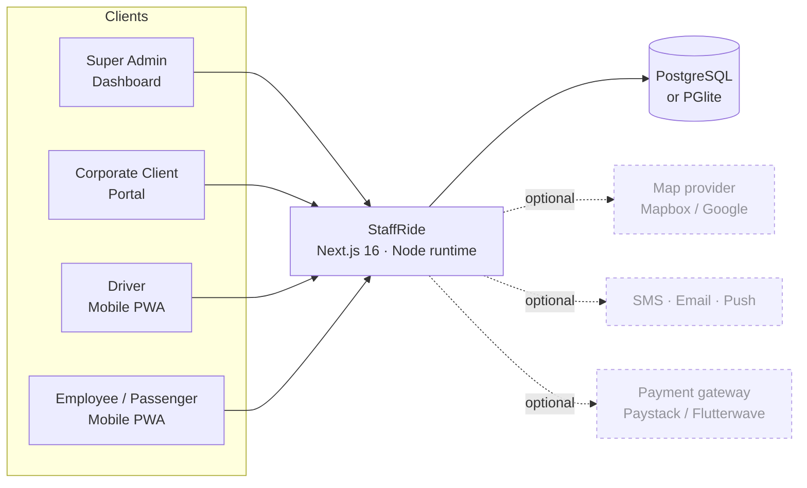
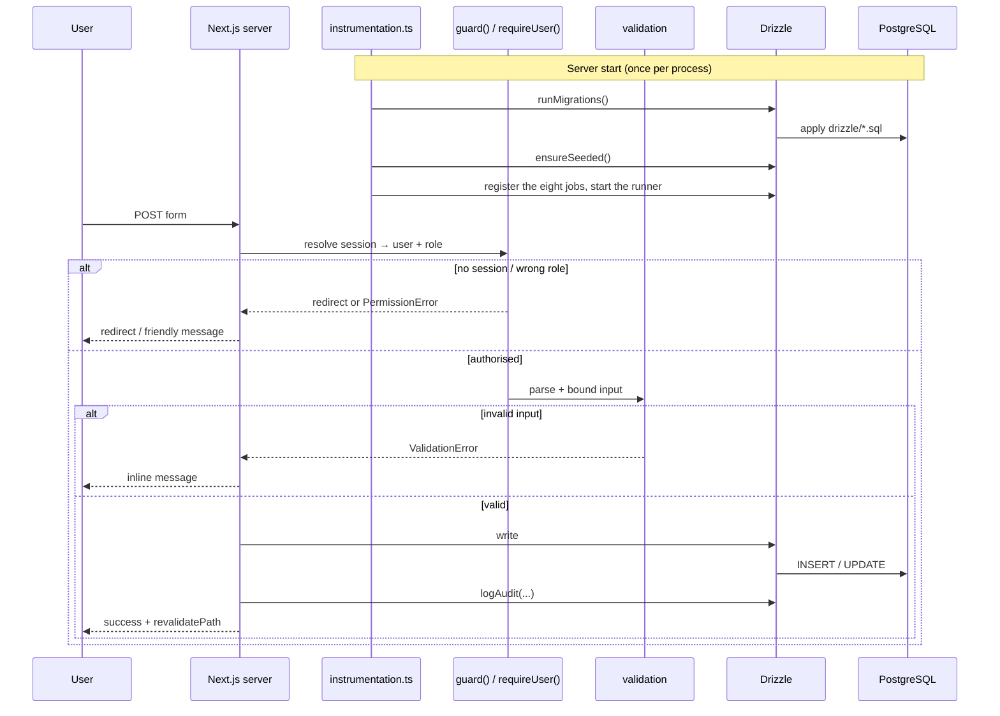
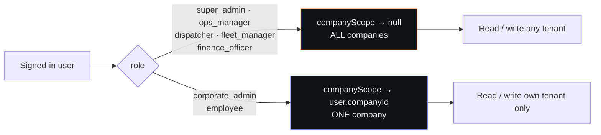
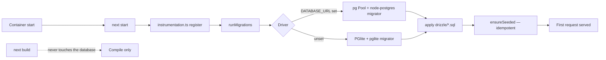
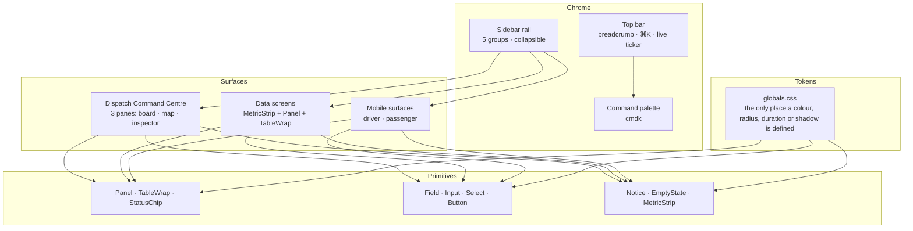
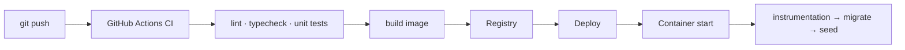

# StaffRide — Architecture

> Mermaid diagrams render on GitHub, in VS Code and in most Markdown viewers.
> Every diagram below describes code that exists in this repository.

---

## 1. System context



Everything optional is labelled in the interface as a demo integration. No
control claims a capability that a missing credential cannot deliver.

---

## 2. Application layers

```mermaid
flowchart TB
    subgraph Presentation
        L1[App Router pages<br/>src/app/(portal) · (auth)]
        L2[UI primitives<br/>src/components/ui]
        L3[Shell<br/>sidebar · topbar · ⌘K palette]
        L4[Client features<br/>dispatch centre · live map · charts]
    end

    subgraph Transport
        A1[Server actions<br/>src/app/actions/*]
        A2[REST routes<br/>src/app/api/*]
    end

    subgraph Domain
        D1[auth.ts — sessions, RBAC guards, audit]
        D2[rbac.ts — role × permission matrix]
        D3[domain.ts — pure rules<br/>routing · capacity · pricing]
        D4[queries.ts — analytics aggregations]
        D5[validation.ts — zod schemas]
        D6[jobs.ts + scheduled-jobs.ts<br/>the runner and the eight jobs]
        D7[vrp.ts — the routing solver]
        D8[currency.ts · pdf.ts · notify.ts<br/>totp.ts · otp.ts · sso.ts]
        D9[observability.ts — logs, counters, percentiles]
    end

    subgraph Data
        B1[db/index.ts<br/>lazy driver + migrations]
        B2[db/schema.ts<br/>Drizzle — 42 tables]
        B3[drizzle/*.sql — 5 migrations]
    end

    L1 --> L2 & L3 & L4
    L1 --> A1
    L2 --> A2
    A1 --> D1 & D2 & D3 & D5
    A2 --> D1 & D2 & D4
    D1 --> B1
    D4 --> B1
    D6 --> B1
    D7 --> B1
    B1 --> B2
    B3 -. applied at boot .-> B1
    M1[proxy.ts<br/>timing, counters, JSON log] -. every request .-> A1 & A2
    M1 --> D9
```

**The job runner and the page bundle share one registry.** Next bundles the
instrumentation hook and the route handlers separately, so a module-level
`Map` of jobs would exist twice: the runner would tick through eight jobs
while the operations screen listed none. The registry therefore lives on
`globalThis`, and the operations screen imports the job module directly so
the list is populated even before the instrumentation hook has run.

**The rule that matters:** the presentation layer never decides authorisation.
A page may hide a button, but the action behind it resolves the permission
again on the server.

---

## 3. Request lifecycle



---

## 4. Database — entity relationship

```mermaid
erDiagram
    COMPANIES ||--o{ COMPANY_BRANCHES : has
    COMPANIES ||--o{ EMPLOYEES : employs
    COMPANIES ||--o{ EMPLOYEE_SHIFTS : defines
    COMPANIES ||--o{ SERVICE_AGREEMENTS : contracts
    COMPANIES ||--o{ ROUTES : plans
    COMPANIES ||--o{ TRIPS : operates
    COMPANIES ||--o{ INVOICES : billed
    COMPANIES ||--o{ INCIDENTS : reports

    USERS ||--o{ SESSIONS : holds
    USERS ||--o{ PASSWORD_RESETS : requests
    USERS ||--o{ LOGIN_ATTEMPTS : attempts
    USERS ||--o{ AUDIT_LOGS : acts
    USERS ||--o{ NOTIFICATIONS : receives
    USERS ||--o{ OTP_CODES : verifies
    USERS ||--o{ LOCATION_CONSENTS : grants
    USERS ||--o{ USER_ROLES : holds

    EMPLOYEES ||--o{ BOOKINGS : makes
    EMPLOYEES ||--o{ ADDRESSES : lives_at
    EMPLOYEE_SHIFTS ||--o{ EMPLOYEES : schedules

    ROUTES ||--o{ ROUTE_STOPS : sequences
    TRIPS ||--o{ BOOKINGS : carries
    TRIPS ||--o{ GPS_EVENTS : tracks
    TRIPS ||--o{ INCIDENTS : raises
    TRIPS ||--o{ TRIP_ASSIGNMENTS : staffed
    TRIPS ||--o{ DRIVER_EARNINGS : accrues

    VEHICLES ||--o{ TRIPS : operates
    VEHICLES ||--o{ MAINTENANCE_RECORDS : serviced
    VEHICLES ||--o{ FUEL_LOGS : refuelled
    VEHICLES ||--o{ SAFETY_INSPECTIONS : inspected

    DRIVERS ||--o{ TRIPS : drives
    DRIVERS ||--o{ DRIVER_EARNINGS : earns
    DRIVERS ||--o{ DRIVER_SHIFTS : works

    BOOKINGS ||--o{ PASSENGER_BOARDINGS : verified_by

    INVOICES ||--o{ INVOICE_LINES : itemised
    INVOICES ||--o{ PAYMENTS : settled_by

    ROLES ||--o{ ROLE_PERMISSIONS : grants
    PERMISSIONS ||--o{ ROLE_PERMISSIONS : included_in

    COMPANIES {
        int id PK
        varchar name
        varchar billing_model
        numeric monthly_rate
        varchar status
    }
    USERS {
        int id PK
        varchar email UK
        varchar password_hash
        varchar role
        int company_id FK
        varchar status
        boolean two_factor_enabled
    }
    SESSIONS {
        varchar token_hash PK
        int user_id FK
        timestamptz expires_at
    }
    TRIPS {
        int id PK
        varchar reference
        int company_id FK
        date trip_date
        timestamptz scheduled_departure
        int booked_seats
        int capacity
        numeric planned_km
        varchar status
    }
    BOOKINGS {
        int id PK
        varchar reference
        int employee_id FK
        int trip_id FK
        int company_id FK
        date booking_date
        int seats
        varchar otp_code
        varchar status
    }
    INVOICES {
        int id PK
        varchar invoice_no
        int company_id FK
        date period_start
        date period_end
        numeric total
        numeric amount_paid
        varchar status
    }
```



**Indexing strategy.** Every hot path is indexed: `trips(trip_date, status)`,
`bookings(company_id, booking_date)`, `gps_events(trip_id, recorded_at)`,
`audit_logs(created_at)`, `audit_logs(company_id)`,
`login_attempts(identifier, created_at)`, `driver_earnings(driver_id, period_start)`.

**Deletion semantics.** Owned children cascade (`employees → bookings`,
`users → sessions`). Optional references null out (`trips.vehicle_id`,
`trips.driver_id`) so a record is never silently deleted because a vehicle was
retired.

**Retention.** GPS events 90 days, audit logs 24 months, sessions 7 days.
`src/lib/domain.ts` exposes `retentionDate()`; the purge job is listed as
pending in `docs/FEATURE-CHECKLIST.md`.

---

## 5. Multi-tenancy



`companyScope(user)` in `src/lib/auth.ts` is the single resolver. Every page
and every action that touches tenant data calls it — or one of the
`resolveBranchId` / `resolveShiftId` helpers — before it writes. The CSV export
route uses the same helper rather than a second copy of the rules.

---

## 6. Authentication and session security

```mermaid
flowchart TB
    A[Login form] --> B[Rate limit<br/>5 failures / 15 min per identifier]
    B --> C[scrypt verify — async]
    C -->|fail| D[recordLoginAttempt(false)<br/>generic error]
    C -->|pass + 2FA| E[recordLoginAttempt(true)]
    E --> F[generateToken 48 bytes]
    F --> G[Cookie: tms_session<br/>httpOnly · sameSite=lax · secure]
    F --> H[(sessions.token_hash<br/>= SHA-256(token))]

    I[Password reset] --> J[hashToken(token)]
    J --> K[(password_resets.token_hash)]
    L[Reset form] --> M[hashToken(submitted)] --> N[Lookup by hash]

    style H fill:#0f1214,stroke:#33ffac,color:#f0f5fa
    style K fill:#0f1214,stroke:#33ffac,color:#f0f5fa
```

Raw tokens exist only in the client cookie. The database stores only hashes.
The password-reset flow invalidates every session on completion, as does
"change my password" and the admin "Sign out" action.

---

## 7. Migrations and boot



The database driver is created **lazily**. `next build` imports every route
module to collect page data, so a module-scope connection would make the
build depend on a live database and would apply migrations during a compile.
Both are now impossible.

---

## 8. Interface architecture



`DESIGN.md` holds the full contract: the Abyss→Carbon→Obsidian→Charcoal ramp,
Signal Orange as the single chromatic authority, status lights that always
pair a dot with a word, 8px containers, pill actions, no drop shadows, and
motion limited to 120/180/320 ms on `cubic-bezier(.2,.8,.2,1)`.

---

## 9. Deployment



`Dockerfile` is a three-stage build: dependency install, Next build, then a
runtime image with only production dependencies. Migrations are **not** baked
into the image — they are applied at container start, so a rolling deploy
migrates exactly once, at boot, against the live database.

---

## 10. Source map

```text
src/
  app/
    (auth)/            login · register · forgot/reset password · otp
    (portal)/          26 role-aware workspace screens
    actions/           admin.ts (22) · ops.ts (19) · auth.ts (12) · platform.ts (8)
    api/               health · metrics · dispatch/live · driver/sync · jobs
                       reports/export · reports/pdf · search · views/save
                       views/delete · auth/* (9) · test/session (QA only)
    offline/           the service-worker's offline shell
    fonts.ts           self-hosted Inter / Space Grotesk / JetBrains Mono
    globals.css        every design token
    instrumentation.ts migrate + seed + register the jobs at server start
    proxy.ts           timing, request counters, one JSON log line per request
  components/
    ui/                Panel · TableWrap · StatusChip · Field · Button · …
                       pagination.tsx
    shell/             sidebar · topbar · command palette · theme provider
    dispatch/          the Dispatch Command Centre
    marketing/         hero visual · step path
    charts.tsx         hand-drawn SVG charts
    live-map.tsx       the vector map
    action-form.tsx    progressive server-action forms
    saved-views.tsx    the saved-filter chip bar
  db/
    index.ts           lazy driver · runMigrations()
    schema.ts          42 tables
  lib/
    auth.ts            sessions · guards · throttling · audit · scope
    rbac.ts            8 roles · 20 sections · 15 permissions
    domain.ts          pure rules — routing, capacity, pricing, transitions
    queries.ts         9 analytics aggregations
    validation.ts      zod schemas and bounded form readers
    status.ts          the status vocabulary
    jobs.ts            the runner · the global job registry
    scheduled-jobs.ts  the eight registered jobs
    notify.ts          notification fan-out with a real delivery status
    currency.ts        multicurrency · conversion · formatting
    totp.ts            RFC 6238 authenticator codes
    otp.ts             hashed phone one-time codes
    sso.ts             OIDC authorisation-code flow with PKCE
    observability.ts   JSON logs · counters · latency percentiles
    pdf.ts             the dependency-free PDF writer
    vrp.ts             Clarke-Wright savings + 2-opt routing solver
    billing.ts         the shared invoice builder
    backup.ts          pg_dump and PGlite archives
    views.ts           saved filter sets
    seed.ts            idempotent demonstration dataset
    seed-ext.ts        roles, addresses, assignments, fuel, inspections, rates
drizzle/               5 migrations
tests/                 15 domain tests
scripts/               audit-authz.py · smoke.mjs · auth-form.mjs
                       action-invoke.mjs · demo.mjs · copy-migrations.mjs
```
